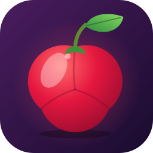

<p align="center">
  
</p>

<h1 align="center">Aceris</h1>

<p align="center">
  Um emulador de um certo console de 2 telas, escrito em Rust, para PC e Android.
</p>

> **Estado verificado em 25/11/2026 — HEAD `3b85bf258d8d197ad1dafc79333f8fdbcf7c8574`.** CI aprovada em Linux, Windows, macOS e Android `arm64-v8a` (workflow [45603812470](https://github.com/CarlosCosta07-s/Aceris/actions/runs/45603812470)). O homebrew Lua Player Plus Cookie Clicker em CIA NoCrypto já produziu sua primeira imagem guest-driven: após 450 quadros com orçamento de 4 milhões de instruções, a tela superior mostrou a abertura do port ("PORT BY" / "CRECKERYOP"), com 192.000 pixels escritos por lista. A tela inferior ainda permanece preta; `Sound.init` continua falhando. Isso demonstra progresso de boot e renderização, não gameplay jogável nem compatibilidade comercial.

O Aceris possui núcleo ARM11/Thumb, MMU/TLB, VFPv2, memória/cache esparsa, loaders CIA/NCSD/NCCH/3DSX, kernel/SVC/IPC parcial, serviços HLE, GPU PICA200 em evolução (incluindo a unidade procedural conectada ao TEV), DSP HLE e frontends nativos em desenvolvimento. O primeiro homebrew real já produziu uma imagem pela cadeia guest → GSP → PICA200 → LCD, mas a tela inferior e o áudio seguem pendentes. Os diagnósticos de falha de serviço HLE agora também aparecem no frontend Android ao sair do jogo. Não há compatibilidade jogável comprovada. Consulte o [roadmap](docs/ROADMAP.md), [arquitetura](docs/ARCHITECTURE.md), [frontends](docs/FRONTENDS.md), [regras de pesquisa](docs/INDEPENDENT_RESEARCH.md) e [benchmark](docs/PERFORMANCE_TESTING.md).

O nome vem da **acerola**, a pequena fruta vermelha cheia de energia.

## Princípios

- **Implementação original.** Todo código do produto é escrito independentemente em Rust. Fontes open source de outros emuladores podem ser consultadas como referência técnica após verificação da licença do projeto e do arquivo; código, assets e testes não são copiados, traduzidos, portados nem reproduzidos estruturalmente. Veja as [regras obrigatórias para IAs](docs/REGRAS_PARA_IA.md), a [pesquisa técnica independente](docs/INDEPENDENT_RESEARCH.md) e a [política de contribuição](CONTRIBUTING.md).
- **Rust de ponta a ponta**, com um núcleo independente de plataforma.
- **Sem crates Rust externos no produto:** somente biblioteca padrão e crates internos do workspace.
- **PC e Android** compartilhando o mesmo núcleo.
- **Sem conteúdo protegido.** O projeto não inclui nem distribui jogos, firmware ou
  chaves. Você precisa usar arquivos obtidos legalmente dos seus próprios dispositivos.

## Estrutura

```
aceris/
├── crates/
│   ├── aceris-common/    erros e utilitários compartilhados
│   └── aceris-core/      núcleo de emulação (CPU, memória, loader, sistema)
├── frontends/
│   ├── desktop/          binário `aceris` com backends X11, Win32 e Cocoa
│   └── android/          NativeActivity e biblioteca Rust nativa (cdylib)
├── assets/icon/          ícone (SVG, PNGs, .ico)
├── tools/                scripts de desenvolvimento
└── docs/                 arquitetura, roadmap, pesquisa e benchmark
```

Mais detalhes em [docs/ARCHITECTURE.md](docs/ARCHITECTURE.md),
[docs/ROADMAP.md](docs/ROADMAP.md), [docs/INDEPENDENT_RESEARCH.md](docs/INDEPENDENT_RESEARCH.md)
e no guia de [personalização e frontends](docs/FRONTENDS.md).

## Compilando

Requer o [Rust](https://rustup.rs) estável (1.85 ou mais recente).

```sh
cargo build            # compila núcleo e frontend desktop
cargo test --workspace # roda os testes
cargo run -- --help    # executa o frontend desktop
cargo run -- --selftest # roda o autoteste da CPU
```

### Android

```sh
rustup target add aarch64-linux-android
cargo install cargo-ndk
cargo ndk -t arm64-v8a build -p aceris-android --release
```

É necessário ter o Android NDK instalado (`ANDROID_NDK_HOME`). O projeto inclui NativeActivity em Rust, manifest e lógica nativa. A CI valida compilação ARM64; empacotamento APK e execução em aparelho físico ainda precisam de validação. Consulte [docs/ANDROID_BUILD.md](docs/ANDROID_BUILD.md).

## Ícone

O ícone é um desenho original, gerado por uma ferramenta própria em Rust,
[`tools/icongen`](tools/icongen), sem dependências externas. Uma única descrição
vetorial produz o SVG, os PNGs, o `.ico` do Windows e os ícones adaptativos do Android:

```sh
cargo run --release -p aceris-icongen
```

Paleta, regras de uso e pendências: [`docs/IDENTIDADE_VISUAL.md`](docs/IDENTIDADE_VISUAL.md).


## Licença

[MIT](LICENSE).
