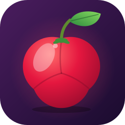

<p align="center">
  
</p>

<h1 align="center">Aceris</h1>

<p align="center">
  Um emulador de um certo console de 2 telas, escrito em Rust, para PC e Android.
</p>

> **Status: fase inicial (v0.0.1).** O projeto ainda não executa jogos. Hoje existe
> o workspace, os frontends mínimos (PC e Android) e um interpretador ARM funcional
> no núcleo compartilhado. Veja o [roadmap](docs/ROADMAP.md).

O nome vem da **acerola**, a pequena fruta vermelha cheia de energia.

## Princípios

- **Código 100% original.** O Aceris é escrito do zero. Nenhum código, interface ou
  recurso de outros emuladores é usado ou traduzido. Veja as [regras obrigatórias para IAs](docs/REGRAS_PARA_IA.md)
  e a [política de contribuição](CONTRIBUTING.md).
- **Rust de ponta a ponta**, com um núcleo independente de plataforma.
- **Sem crates Rust externos no produto:** somente biblioteca padrão e crates internos do workspace.
- **PC e Android** compartilhando o mesmo núcleo.
- **Sem conteúdo protegido.** O projeto não inclui nem distribui jogos, firmware ou
  chaves. Você precisa usar arquivos obtidos legalmente dos seus próprios dispositivos.

## Estrutura

```
aceris/
├── crates/
│   ├── aceris-common/    erros e utilitários compartilhados
│   └── aceris-core/      núcleo de emulação (CPU, memória, loader, sistema)
├── frontends/
│   ├── desktop/          binário `aceris` (Windows, Linux, macOS)
│   └── android/          biblioteca nativa (cdylib) + recursos do app (ícones)
├── assets/icon/          ícone (SVG, PNGs, .ico)
├── tools/                scripts de desenvolvimento
└── docs/                 arquitetura e roadmap
```

Mais detalhes em [docs/ARCHITECTURE.md](docs/ARCHITECTURE.md) e
[docs/ROADMAP.md](docs/ROADMAP.md).

## Compilando

Requer o [Rust](https://rustup.rs) estável (1.85 ou mais recente).

```sh
cargo build            # compila núcleo e frontend desktop
cargo test --workspace # roda os testes
cargo run -- --help    # executa o frontend desktop
cargo run -- --selftest # roda o autoteste da CPU
```

### Android

```sh
rustup target add aarch64-linux-android
cargo install cargo-ndk
cargo ndk -t arm64-v8a build -p aceris-android --release
```

É necessário ter o Android NDK instalado (`ANDROID_NDK_HOME`). A aplicação Android e sua interface também deverão ser implementadas em Rust;
o crate atual gera apenas a biblioteca nativa.

## Ícone

O ícone é um desenho original, gerado por [`tools/generate_icons.py`](tools/generate_icons.py)
a partir de um único SVG (precisa de `rsvg-convert` e ImageMagick). Ele cria o SVG
mestre, os PNGs, o `.ico` do Windows e os ícones adaptativos do Android.


## Licença

[MIT](LICENSE).
